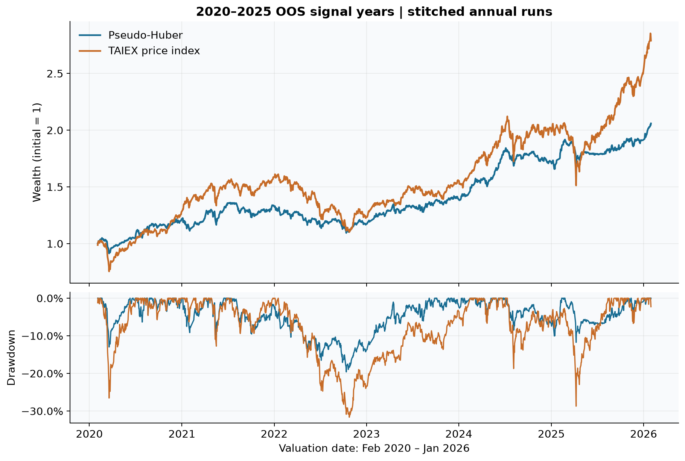
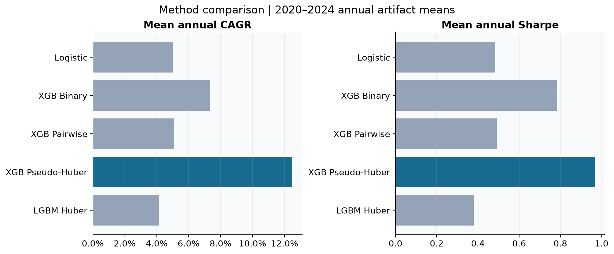
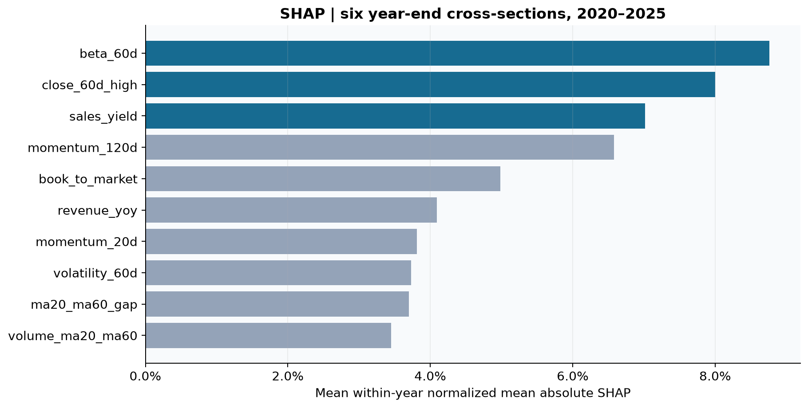

# AI Quant Research

**台股多因子機器學習選股｜數據分析與機器學習職前訓練專題**

以量化分析師／機器學習工程師面試作品為目標，建立從時點資料、27 個因子、年度模型驗證，到扣成本 OOS 回測、SHAP 與儀表板的完整研究流程。最終 Pseudo-Huber 策略的六年串接年化報酬為 **13.24%**、最大回撤 **−19.59%**；同期 TAIEX 為 **19.31%**、**−31.63%**。成果呈現較淺回撤與較低報酬，尚不足以宣稱可穩定打敗市場。

📄 **[完整研究成果](研究成果.md) · [圖文版 PDF](output/pdf/研究成果.pdf)**

An end-to-end research platform for multi-factor equity selection in the Taiwan stock market. The repository covers data ingestion, point-in-time feature engineering, monthly panel construction, model training, out-of-sample portfolio simulation, research diagnostics, and a Streamlit dashboard.

The current research focus is cross-sectional stock ranking: buy the highest-ranked 15 stocks at each monthly rebalance and retain existing holdings until they fall below rank 30. The system compares classification, learning-to-rank, robust regression, and linear baselines under the same portfolio and transaction-cost assumptions.

> This is a research project, not investment advice. Historical and simulated results do not guarantee future performance.

## Research highlights

- **Point-in-time data discipline.** Historical decisions use information available on each signal date. Factor v4 requires same-day market value, announced financial data, sufficient adjusted-price history, and a minimum listing age.
- **Corporate-action-aware returns.** Technical factors, labels, and forward 20-trading-day returns use adjusted prices. Nominal prices remain in use where the economic definition requires them, such as market capitalization and trade execution.
- **Leakage-aware validation.** Annual experiments use four training years, one validation year, a 20-trading-day purge, and a separate OOS year.
- **Several modeling objectives.** The training interface supports XGBoost binary classification, `rank:pairwise`, pseudo-Huber regression, and a fixed Logistic Regression baseline.
- **Portfolio-level evaluation.** Runs include transaction fees, securities transaction tax, slippage, volatility targeting, individual-weight limits, and a TAIEX MA60 exposure rule.
- **Selection diagnostics.** In addition to portfolio P&L, the dashboard reports continuous Rank IC, Top-15 actual excess return, Top-Bottom spread, SHAP values, and XGBoost gain.
- **Reproducible research artifacts.** Monthly panels and trained model artifacts are versioned so existing experiments can be inspected without rebuilding every intermediate dataset.

## Current OOS evidence

### 最終策略：2020–2025 訊號年度

`oos-2020~2025-factor-v4-pseudohuber-NOrefit` 是六個年度 run 的統稱。每年以四年訓練、一年驗證與 50 次 Optuna 選參，凍結模型後進入次年 OOS；NOrefit 指驗證後不合併訓練與驗證資料重訓，並非六年共用同一模型。投組採 **Top15／Hold30、反波動權重、α=1（不平滑）**，並納入交易成本與 TAIEX MA60 曝險控制。

| 六年串接指標 | 策略 | 同期 TAIEX |
| --- | ---: | ---: |
| 年化報酬 CAGR | 13.24% | 19.31% |
| Sharpe | 1.031 | 0.998 |
| Sortino | 1.359 | 1.275 |
| 最大回撤 MDD | -19.59% | -31.63% |
| 累積報酬 | 105.97% | 178.93% |



**評估口徑：**實際估值期間為 **2020-02-03 至 2026-01-30，共 1,464 個交易日**。以上為年度獨立回測的日報酬串接，含各年度首日相對初始資金的報酬，尚非跨年承接持股的單一帳戶重跑。TAIEX 為價格指數，非含息指數；首日以 2020-01-31 收盤為基準，與策略開盤建倉的日內起點略有不同。CAGR 採 252 交易日年化，Sharpe 無風險利率設為 0；Sortino 使用負報酬日的樣本標準差，並非全樣本下檔半變異數版本。

| 訊號年度 | 策略期間報酬 | 大盤期間報酬 | 策略 MDD | 大盤 MDD |
| --- | ---: | ---: | ---: | ---: |
| 2020 | 13.11% | 31.69% | -12.97% | -26.53% |
| 2021 | 10.59% | 16.75% | -10.35% | -12.74% |
| 2022 | -1.86% | -13.63% | -15.53% | -30.93% |
| 2023 | 15.82% | 17.19% | -5.86% | -7.69% |
| 2024 | 22.00% | 31.50% | -10.03% | -18.69% |
| 2025 | 18.74% | 36.29% | -11.74% | -26.71% |

年度期間報酬依各訊號年度的實際持有區間計算，並非曆年報酬或 CAGR。底稿：[年度重算](output/research/research_results_assets/annual_recomputed.csv)、[串接日報酬](output/research/research_results_assets/stitched_daily.csv)。

### 方法比較：共同期間 2020–2024

以下是五個年度 artifact 指標的**算術平均**，不可當成五年串接 CAGR 或整段最大回撤。Logistic、Pairwise、LightGBM 缺少同系列完整 2025 結果，因此僅比較共同期間。

| 方法 | 平均年度 CAGR | 平均 Sharpe | 平均 Sortino | 平均年度 MDD | 平均 Rank IC | 年換手 |
| --- | ---: | ---: | ---: | ---: | ---: | ---: |
| Logistic Regression | 5.05% | 0.484 | 0.727 | -11.02% | -0.064 | 6.21x |
| XGBoost Binary | 7.35% | 0.785 | 1.184 | -9.11% | -0.063 | 5.71x |
| XGBoost Pairwise | 5.08% | 0.491 | 0.764 | -12.07% | -0.069 | 7.69x |
| XGBoost Pseudo-Huber | **12.48%** | **0.967** | **1.353** | -10.95% | **0.034** | 10.16x |
| LightGBM Huber | 4.14% | 0.379 | 0.563 | -13.15% | 0.033 | 8.70x |



Pseudo-Huber 在這組實驗中表現較佳，但換手偏高。LightGBM Huber 同樣有正 IC，投組績效卻較低，顯示選股診斷與經濟成果需分開評估。比較同時涉及演算法、損失實作與搜尋空間，不能視為純 objective 的因果實驗。逐年明細見 [methods_annual.csv](output/research/research_results_assets/methods_annual.csv)。

### 投組與訓練設計的研究發現

| 比較 | 範圍 | 主要結果 |
| --- | --- | --- |
| 排名緩衝 | 2020–2024 保存實驗 | Top15/Hold15 → Top15/Hold30，平均換手 10.76 → 10.09x，平均 CAGR 13.62% → 12.71%；Top30/Hold60 為 7.43%。擴大投組未改善平均績效。 |
| 反波動 vs 等權 | 2020–2024 | 平均 CAGR 12.48% vs 11.43%，Sharpe 0.967 vs 0.821；兩組平均總曝險相同，差異來自個股配置。 |
| 月中資料增廣 | 僅 2024 OOS | 訓練樣本 21,056 → 41,900，CAGR 23.82% → 13.10%，但回撤與換手降低；增加樣本未改善此年泛化成果。 |
| 分數平滑 | 2020–2024 | α=0.8／0.6／0.4 的平均 CAGR 為 6.87%／9.02%／7.43%，低於 α=1 的 12.48%；最終保留不平滑。 |
| Binary class weight | 2020–2025 | 固定參數、正類 4:1 加權後，串接 CAGR 7.53% → 6.33%，Sharpe 0.701 → 0.588；不納入 class weight＋Optuna 組。 |
| 移除 beta_60d | 2020–2025 消融 | 固定參數移除後平均 IC 提升，但 Sharpe 與 Top15 excess 下降；配對 Bootstrap 差異區間涵蓋 0，不能宣稱 Beta 是不可替代的 Alpha。 |

**版本與口徑限制：**緩衝比較保留原批次 12.71% 基準，不與後來重物化的 12.48% 混排；平滑變體也有物化版本差異。Class weight 的串接口徑未包含各年度首日報酬，不能直接與首頁績效排名。完整實驗條件及來源見 [研究成果](研究成果.md)。

### 特徵解釋與 Bootstrap 情境模擬

SHAP Top3 為 **beta_60d（8.8%）、close_60d_high（8.0%）、sales_yield（7.0%）**。這是六個年度最後訊號截面的 mean(|SHAP|) 各自正規化後等權平均，並非全年重要度、報酬貢獻或因果證據。



以 72 個歷史持有月份抽取一年路徑，各模擬 5,000 次：

| 抽樣方法 | 一年累積報酬中位數 | P5–P95 | 虧損機率 |
| --- | ---: | ---: | ---: |
| 單月 IID | 12.79% | -7.90%～38.27% | 16.04% |
| 三個月 circular block | 12.64% | -5.32%～33.54% | 13.68% |

這是歷史月份重複出現的情境分布，不是未來報酬預測或平均績效信賴區間。路徑沿用已扣成本日報酬，接縫不重建持股或追加換倉成本；區塊法也不保證尾部風險更保守。

### 研究文件與可重現性

- [完整研究成果 Markdown](研究成果.md)：指標定義、實驗比較、限制及來源。
- [研究成果 PDF](output/pdf/研究成果.pdf)：適合閱讀與面試分享的圖文版。
- [圖表與重算底稿](output/research/research_results_assets/)：PNG／SVG、逐年指標、日報酬及 SHAP 摘要。
- [來源指紋](output/research/research_results_assets/provenance.json)：記錄使用 artifact 的 SHA-256，便於辨識後續資料異動。
- [早期面試簡報（2026-10-05）](output/pptx/taiwan_quant_research_interview_2026-10-05.pptx)：歷史版本；最新研究數字以本次研究成果為準。

完整重建需要已填入資料的本地研究資料庫；僅閱讀報告、PDF 與圖表不需要資料庫。

## System overview

```text
FinMind / official sources / Shioaji / yfinance
                    |
                    v
         SQLite point-in-time data store
                    |
                    v
        Monthly universe and factor panels
                    |
                    v
   Train -> validate -> freeze model -> OOS score
                    |
                    v
 Portfolio construction, costs, risk controls, metrics
                    |
                    v
             Streamlit dashboard
```

### Data and universe

The default factor v4 configuration applies these core rules:

- Taiwan-listed securities with at least 252 trading days of history
- Minimum market capitalization of TWD 5 billion
- Minimum 20-day average traded value of TWD 20 million
- Minimum nominal share price of TWD 10
- At least 121 adjusted-price observations
- Required point-in-time financial fields: net income and equity
- Missing critical data removes a stock from the eligible universe before label ranking
- Non-critical cross-sectional missing values use monthly median imputation without missing-value indicator features

The label is the stock's adjusted 20-trading-day forward return, ranked within that month's eligible universe. The binary objective marks the top 20% as positive. The pseudo-Huber objective predicts continuous excess return relative to the monthly universe mean.

### Portfolio rules

The baseline portfolio configuration uses:

- Buy rank: Top 15
- Holding buffer: retain until rank falls below 30
- Maximum individual weight: 10%
- Target annual volatility: 15%
- Maximum equity exposure: 100%
- Reduced exposure below the TAIEX 60-day moving average: 50%
- Signal at month-end close and execution at the next trading-day open
- Broker fee, sell tax, and per-side slippage included in simulation

## Dashboard

The Streamlit dashboard contains five research views:

1. **Overview** — strategy and TAIEX CAGR, Sharpe, Sortino, drawdown, NAV, drawdown path, and monthly returns.
2. **Portfolio** — historical holdings by signal month, stock names, weights, ranks, volatility, and beta.
3. **Model** — continuous IC, Top-15 excess return, Top-Bottom spread, SHAP, gain, and prediction distributions.
4. **Risk** — equity exposure, forecast and realized volatility, market regime, drawdown, and turnover.
5. **Research comparison** — transaction-cost and sensitivity comparisons across completed runs.

Runs can be filtered by factor version, OOS year, method, and score-smoothing coefficient.

Start the dashboard on Windows:

```powershell
.\start_dashboard.bat
```

Or start it directly from an activated environment:

```bash
python -m streamlit run app.py --server.port 8501
```

Then open <http://localhost:8501/>.

### Local real-time fund monitor

The repository also includes a local operations dashboard for the simulated
`oos-2026-ytd-factor-v4-pseudohuber-NOrefit` fund. It reconstructs the current
nominal share book from OOS orders, anchors valuation to the materialized OOS NAV,
and applies Shioaji stock and TAIEX quotes to the live price delta. The research
database remains read only; minute snapshots are stored separately in
`database/realtime_monitor.db`.

```powershell
.\start_realtime_monitor.bat
```

Open <http://127.0.0.1:8601/>. When Shioaji credentials are absent or login fails,
the monitor clearly switches to the latest stored nominal closes. It polls the
research run every minute, so a newly materialized monthly signal and its OOS
orders roll the monitored book forward without restarting the web page.

## Installation

Python 3.12 is the tested environment; project metadata allows Python 3.10 or newer.

```bash
git clone https://github.com/povmaru888/AI_Quant_Research.git
cd AI_Quant_Research
python -m venv .venv
```

Activate the environment:

```powershell
# Windows PowerShell
.\.venv\Scripts\Activate.ps1
```

```bash
# Linux or macOS
source .venv/bin/activate
```

Install the pinned dependencies:

```bash
python -m pip install --upgrade pip
python -m pip install -r requirements.txt
```

Copy the environment template and add only the credentials required for the data sources you intend to use:

```powershell
Copy-Item .env.example .env
```

```bash
cp .env.example .env
```

Supported environment keys include `FINMIND_TOKEN`, `SHIOAJI_API_KEY`, and `SHIOAJI_SECRET_KEY`. `.env` and live SQLite databases are intentionally excluded from version control.

## Reproducing the pipeline

### 1. Initialize the database

```bash
python tools/init_db.py --config config.factor_v4.yaml
```

### 2. Seed the stock master and TAIEX

```bash
python tools/seed_stocks.py --config config.factor_v4.yaml --start 2014-06-01
```

### 3. Synchronize historical data

FinMind access varies by account tier. The repository provides full-market and per-symbol workflows, plus repair utilities for adjusted prices, market-value gaps, and exceptional Saturday trading sessions.

Example per-symbol free-tier synchronization:

```bash
python tools/sync_free.py \
  --config config.factor_v4.yaml \
  --start 2015-01-01 \
  --feeds all
```

Example PIT market-value synchronization:

```bash
python tools/sync_market_values.py \
  --config config.factor_v4.yaml \
  --start 2015-01-01 \
  --end 2024-12-31
```

### 4. Build monthly factor panels

```bash
python tools/build_panels.py \
  --config config.factor_v4.yaml \
  --start 2019-01 \
  --end 2023-12 \
  --out data/panels_v4
```

The panel builder uses fingerprints and atomic writes. Valid cached months are reused unless `--force` is supplied.

For a training-only midmonth snapshot, use a separate output directory. A non-trading
15th resolves to the latest trading day on or before it:

```bash
python tools/build_panels.py \
  --config config.factor_v4.yaml \
  --start 2019-01 \
  --end 2022-11 \
  --schedule midmonth \
  --out data/panels_v4_midmonth
```

### 5. Train and validate a model

Pseudo-Huber example for an OOS 2024 study:

```bash
python tools/train_model.py \
  --config config.factor_v4.yaml \
  --panels data/panels_v4 \
  --train-start 2019-01 \
  --train-end 2022-11 \
  --purge-month 2022-12 \
  --valid-start 2023-01 \
  --valid-end 2023-12 \
  --trials 50 \
  --objective reg:pseudohubererror \
  --out models/model_oos2024_v4_pseudohuber
```

Use `--params-from <prior-report.json>` to reuse previously selected XGBoost parameters and skip Optuna. Logistic Regression uses its fixed baseline specification and does not run Optuna.

Controlled data-augmentation studies can add one extra training snapshot per month
while leaving validation unchanged. This mode requires `--params-from` and freezes
the baseline report's feature order and hyperparameters:

```bash
python tools/train_model.py \
  --config config.factor_v4.yaml \
  --panels data/panels_v4 \
  --extra-train-panels data/panels_v4_midmonth \
  --train-start 2019-01 \
  --train-end 2022-11 \
  --purge-month 2022-12 \
  --valid-start 2023-01 \
  --valid-end 2023-12 \
  --params-from models/model_oos2024_validation_2019_2022_v4_pseudohuber_NOrefit/report.json \
  --objective reg:pseudohubererror \
  --out models/model_oos2024_validation_2019_2022_v4_pseudohuber_midmonth_augmented_NOrefit
```

### 6. Run a frozen-model OOS portfolio simulation

```bash
python tools/run_oos_portfolio.py \
  --config config.factor_v4.yaml \
  --model models/model_oos2024_v4_pseudohuber \
  --model-version xgb_pseudohuber_oos2024 \
  --start 2024-01 \
  --end 2024-12 \
  --panels data/panels_v4 \
  --run-id oos-2024-factor-v4-pseudohuber-NOrefit
```

The final December signal is valued through its full 20-trading-day horizon in the following January.

### 7. Repair historical daily-price gaps efficiently

The gap-driven price synchronizer first audits the local database and downloads
one full-market official TWSE or TPEx response per affected date. Adjusted prices
come only from FinMind; all missing dates for the same stock are combined into one
minimal request range to conserve the free hourly allowance.

Review the request plan without downloading data:

```bash
python tools/sync_prices_fast.py \
  --config config.factor_v4.yaml \
  --start 2026-09-01 \
  --end 2026-10-23 \
  --dry-run \
  --resume
```

Execute the same repair and save a machine-readable profile:

```bash
python tools/sync_prices_fast.py \
  --config config.factor_v4.yaml \
  --start 2026-09-01 \
  --end 2026-10-23 \
  --resume \
  --profile-json reports/price_sync_profile.json
```

All FinMind callers share a persistent 540-request rolling hourly budget. Set
`FINMIND_REQUESTS_PER_HOUR` only when the account limit changes.

## Repository layout

```text
app.py                 Streamlit application shell
config*.yaml           Research, universe, portfolio, and execution settings
src/integrations/      FinMind, Shioaji, yfinance, Telegram, and Gemini adapters
src/repositories/      Database access and idempotent persistence
src/runtime/           Runtime data preparation and database-backed store
src/services/          Features, labels, models, portfolio, risk, and metrics
src/ui/                Dashboard pages and shared visual theme
tools/                 Data, panel, training, OOS, audit, and repair commands
tests/                 Unit, integration, PIT, cache, and failure-path tests
data/panels*/          Versioned monthly research panels
models/                Versioned trained models and reports
output/                Shareable research artifacts
```

## Data availability after cloning

The repository includes versioned panel and model artifacts used for existing research. It does **not** include the live `database/quant.db` file because it is large, machine-specific, and may contain locally synchronized data.

Therefore:

- You can inspect the source code, configuration, committed panels, models, and presentation after cloning.
- To run new data synchronization, build fresh panels, materialize runs, or populate the dashboard, initialize and populate a local database first.
- Dashboard run metadata and detailed holdings are read from the local database, so cloning alone does not reproduce the original machine's complete dashboard state.

## Quality controls

The CI workflow runs dependency validation, Ruff linting, format checks, and pytest on every push and pull request.

```bash
python -m pip check
ruff check src tests
ruff format --check src tests
python -m pytest -q
```

The test suite covers point-in-time boundaries, adjusted-price behavior, labels, panel caching and recovery, model persistence, OOS materialization, database key isolation between runs, dashboard rendering, and failure handling.

## Research limitations

- The research history contains only a limited number of annual OOS regimes.
- Hyperparameter selection and repeated experimentation can still create research overfitting even when each individual run is temporally valid.
- Turnover, taxes, fees, and slippage are modeled, but actual market impact and capacity require further analysis.
- Relative performance varies substantially by market regime; strong absolute returns do not necessarily imply benchmark outperformance.
- Data-source availability and revisions can affect reproducibility across accounts and dates.

The next research priorities are turnover-aware optimization, sector and size neutralization, capacity analysis, and a longer rolling OOS record.

## Technology

Python, pandas, NumPy, SQLAlchemy, SQLite, XGBoost, scikit-learn, Optuna, SHAP, vectorbt, Plotly, Streamlit, pytest, and Ruff.
