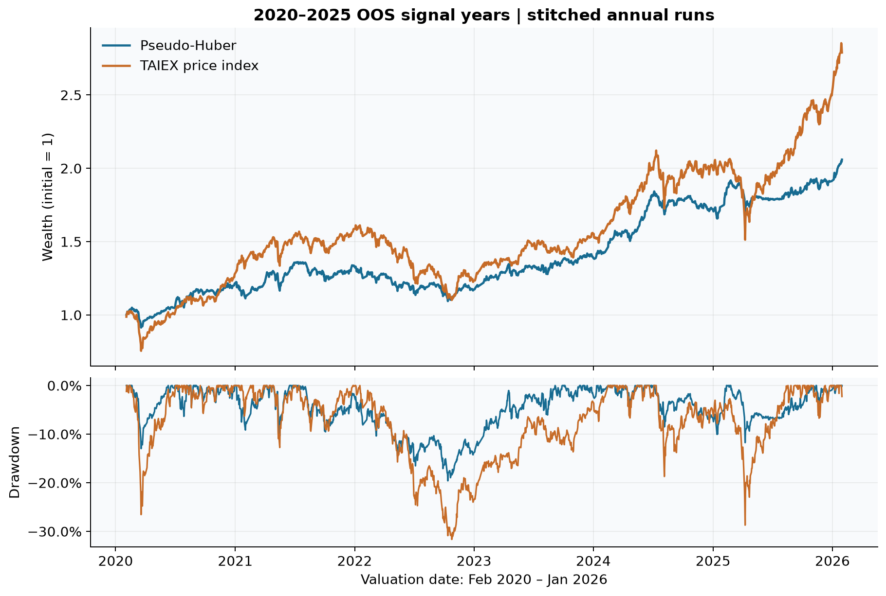
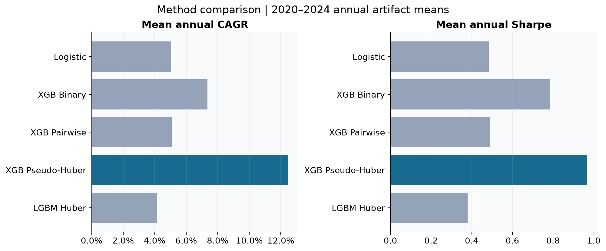
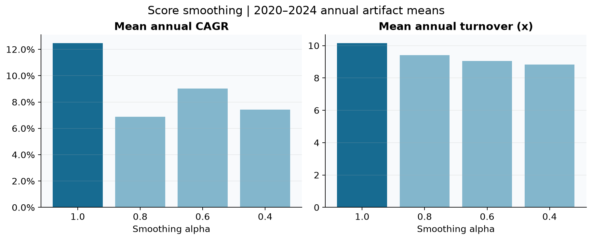
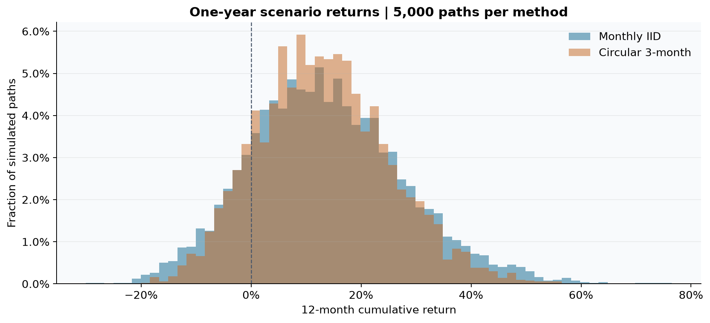
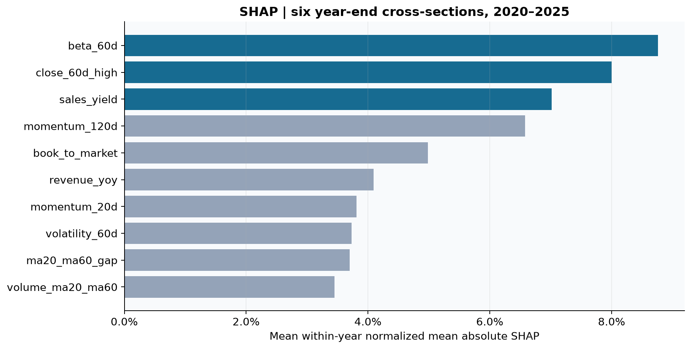

# 台股多因子機器學習選股｜研究成果

> 數據分析與機器學習職前訓練專題 · 適合職缺為金融量化分析師／機器學習工程師  
> 首頁為摘要內容單元；Markdown 本身不保證實體頁數，轉 PDF 時依分頁標記排版。

## 第一頁｜摘要與結論

**核心成果：完成可追溯的台股選股研究流程。最終 XGBoost Pseudo-Huber 在六年串接 OOS 呈現正報酬與較淺回撤，但報酬落後同期大盤；較適合定位為控制風險的主動選股研究。**

最終版本：`oos-2020~2025-factor-v4-pseudohuber-NOrefit`（六個年度 run 的統稱）。四年訓練 → 一年驗證 → 次年 OOS；各年度重新訓練及調參，驗證後不合併資料 refit。月末選 Top15，既有持股排名仍在 Top30 可續抱；反波動權重，α=1、不平滑。

```text
FinMind／官方資料等 → SQLite 時點資料 → 股票池＋27 因子月截面
 → Purge／Optuna／凍結年度模型 → 次年 OOS 排名
 → Top15／Hold30＋反波動配置＋大盤 MA60 風控
 → 次日開盤模擬成交／扣成本 → 績效、SHAP、消融、Bootstrap、儀表板
```

| 六年串接指標 | 策略 | 同期 TAIEX |
|---|---|---|
| 年化報酬 CAGR | 13.24% | 19.31% |
| Sharpe | 1.031 | 0.998 |
| Sortino | 1.359 | 1.275 |
| MDD | -19.59% | -31.63% |
| 累積報酬 | 105.97% | 178.93% |

**評估範圍：**2020–2025 為訊號年度，實際估值日期 2020-02-03～2026-01-30，共 1,464 個交易日；含各年度首日相對初始資金的報酬，TAIEX 使用相同日期的收盤對收盤報酬（首日基準為 2020-01-31 收盤）。此為年度獨立回測的報酬串接，尚非跨年承接原持股的單一帳戶重跑。大盤為價格指數，非含息指數。

**SHAP Top3：****beta_60d**（8.8%）；**close_60d_high**（8.0%）；**sales_yield**（7.0%）。此為六個年度「最後一期截面」的 mean(|SHAP|) 各自正規化後等權平均占比，**不是全年 SHAP，也不是報酬貢獻或因果證據**。

**優點：**時點資料與 purge 降低前視風險；將交易成本及曝險控制納入評估；六個年度的平均 Rank IC、Top15 超額與 Top–Bottom spread 均為正；研究輸出可追溯到 run、模型與資料表。

**缺點：**強勢市場追不上大盤；換手偏高（六年度平均約 9.91 倍）

<div style="page-break-after: always;"></div>

## 第二頁｜研究設計與績效口徑

### 問題與驗證方式

研究問題是「能否利用當時已知的基本面、價量、風險與籌碼因子，排序下期較有潛力的股票，並轉成扣成本的可執行投組？」選股能力和投組績效分開檢驗。

| 項目 | 設計 |
|---|---|
| 股票池 | 市值至少 50 億、20 日均成交值至少 2,000 萬、股價至少 10 元、上市滿 252 交易日；v4 要求關鍵財務與調整價資料 |
| 資料處理 | 財報依可得時點、還原價用於因子與標籤；截面缺值填補與極端值處理；排除規則及門檻見 config.factor_v4.yaml |
| 年度切分 | OOS 年 Y：Y−5 至 Y−2 的訓練區間（末月 purge），Y−1 驗證，Y 測試；20 交易日標籤隔離 |
| 最終模型 | 27 個共同特徵；XGBoost `reg:pseudohubererror`；每年 50 次 Optuna；NOrefit |
| 標籤 | 未來 20 個個股交易日還原價報酬；回歸預測相對當期股票池均值的連續超額報酬；二元分類以截面前 20% 為正類 |
| 個股配置 | Top15／Hold30；最多單檔 10%；反波動權重 |
| 總曝險 | 目標年波動 15%、曝險上限 100%、TAIEX 低於 MA60 時採減碼規則 |
| 執行與成本 | 月底收盤訊號、次交易日開盤；手續費單邊 0.1425%、賣出稅 0.3%、滑價單邊 0.1% |

### 必須區分的三種數字

1. **六年串接績效：**首頁由日報酬重新複利，再計算整段 CAGR、Sharpe、Sortino、MDD。年度初始資金均為 3,000 萬，串接時不把帳戶金額重設誤當損益。
2. **年度期間報酬：**每個訊號年度實際持有期間的累積報酬；不是 1 月至 12 月曆年報酬。下表另列同段 CAGR，兩者不能混稱。
3. **比較研究的年度平均：**後文多數表格是五個年度 artifact 指標的算術平均，並非五年 CAGR，平均年度 MDD 也不是整段最大回撤。

本文件首頁及下表採 `CAGR=累積財富^(252/N)−1`；Sharpe 為日平均／日報酬樣本標準差 × √252，無風險利率設為 0；Sortino 沿用專案「日平均／負報酬日樣本標準差 × √252」，**不是以全樣本下檔半變異數計算的版本**。MDD 含起始財富 1。大盤首日含前收至當日收盤變動；策略年度首日由開盤建倉及成本決定，兩者日內起點並非完全一致。

| 訊號年度 | 策略期間報酬 | 大盤期間報酬 | 策略 CAGR | 大盤 CAGR | Sharpe 策／盤 | Sortino 策／盤 | MDD 策／盤 |
|---|---|---|---|---|---|---|---|
| 2020 | 13.11% | 31.69% | 13.22% | 31.98% | 0.98 / 1.44 | 1.27 / 1.87 | -12.97% / -26.53% |
| 2021 | 10.59% | 16.75% | 11.10% | 17.58% | 0.79 / 1.05 | 1.13 / 1.43 | -10.35% / -12.74% |
| 2022 | -1.86% | -13.63% | -1.94% | -14.21% | -0.08 / -0.64 | -0.10 / -0.98 | -15.53% / -30.93% |
| 2023 | 15.82% | 17.19% | 16.10% | 17.49% | 1.35 / 1.41 | 1.98 / 2.23 | -5.86% / -7.69% |
| 2024 | 22.00% | 31.50% | 23.76% | 34.13% | 1.79 / 1.48 | 2.46 / 1.69 | -10.03% / -18.69% |
| 2025 | 18.74% | 36.29% | 18.99% | 36.80% | 1.57 / 1.42 | 1.82 / 1.71 | -11.74% / -26.71% |



**解讀：**低曝險與減碼有助降低下跌損失，也限制多頭參與度。每年選股診斷為正，不等於每月為正，亦不等於投組必定超越 TAIEX。Top15 excess 的基準是當月股票池均值，不是 TAIEX。

來源：`database/quant.db → run_artifacts(metrics/monthly_ic)`、`prices(stock_id=TAIEX)`；重算底稿 [annual_recomputed.csv](output/research/research_results_assets/annual_recomputed.csv) 與 [stitched_daily.csv](output/research/research_results_assets/stitched_daily.csv)。

<div style="page-break-after: always;"></div>

## 第三頁｜不同 method／objective 比較

共同評估期間為 **2020–2024**，因 Logistic、Pairwise、LightGBM 未具同系列完整 2025 結果。下表取整理當下資料庫的年度 artifact 平均，不將不同期間混排。

| 方法 | 平均年度 CAGR | 平均 Sharpe | 平均 Sortino | 平均年度 MDD | 年換手 x | 平均 Rank IC |
|---|---|---|---|---|---|---|
| Logistic Regression | 5.05% | 0.484 | 0.727 | -11.02% | 6.21 | -0.064 |
| XGBoost Binary | 7.35% | 0.785 | 1.184 | -9.11% | 5.71 | -0.063 |
| XGBoost Pairwise | 5.08% | 0.491 | 0.764 | -12.07% | 7.69 | -0.069 |
| XGBoost Pseudo-Huber | 12.48% | 0.967 | 1.353 | -10.95% | 10.16 | 0.034 |
| LightGBM Huber | 4.14% | 0.379 | 0.563 | -13.15% | 8.70 | 0.033 |

| 方法 | 學習目標與比較意義 |
|---|---|
| Logistic Regression | 固定線性二元分類基準；觀察非線性模型是否增加價值 |
| XGBoost Binary | `binary:logistic`；預測進入前 20% 的機率 |
| XGBoost Pairwise | `rank:pairwise`；學習相對排序 |
| XGBoost Pseudo-Huber | `reg:pseudohubererror`；對連續超額報酬採穩健損失 |
| LightGBM Huber | `huber`；另一個樹模型與穩健回歸實作 |



**結論：**在這組已完成實驗中，Pseudo-Huber 的平均報酬、Sharpe 與連續 Rank IC 較佳；Binary 的全截面 IC 可為負但頭部選股仍可能有價值，因此不能只用全域 IC 決定模型。LightGBM Huber 未複製 XGBoost 的結果；此比較同時改變演算法、損失實作與搜尋空間，不能推論 XGBoost 在所有資料上優於 LightGBM，亦非單純 objective 的因果實驗。


來源：[methods_annual.csv](output/research/research_results_assets/methods_annual.csv)、[lightgbm_huber_vs_xgboost_pseudohuber_summary_2020_2024.csv](lightgbm_huber_vs_xgboost_pseudohuber_summary_2020_2024.csv)。表格只代表已完成的模型，未虛構其他 XGBoost／LightGBM objective。

<div style="page-break-after: always;"></div>

## 第四頁｜投組緩衝與權重

### 不同緩衝與投組規模（2020–2024 保存實驗）

| 規則 | 平均 CAGR | 平均 Sharpe | 平均 Sortino | 平均年度 MDD | 換手 x | 平均持股數 |
|---|---|---|---|---|---|---|
| Top15/Hold15 | 13.62% | 0.944 | 1.283 | -11.87% | 10.76 | 15.0 |
| Top15/Hold30 | 12.71% | 0.921 | 1.275 | -11.45% | 10.09 | 16.1 |
| Top30/Hold60 | 7.43% | 0.664 | 0.868 | -11.37% | 10.26 | 33.4 |

Top15／Hold15 相當於沒有排名緩衝；Hold30 可讓跌出前 15、但仍在前 30 的舊持股續抱，所以實際檔數可能大於 15。加入 Hold30 後平均換手由 10.76 降至 10.09 倍，但 CAGR 也下降，並未同時改善所有指標。Top30／Hold60 同時增加新買入數量與續抱範圍，不能把全部差異歸因於緩衝。

本表保留原比較 CSV 的同批基準（12.71%），不將後來重物化的 12.48% 插入舊對照。尚未重跑全部變體驗證現行資料下是否同方向。

### 更寬的續抱門檻：僅有 2020，不外推五年

| 方法 | 平均年度 CAGR | 平均 Sharpe | 平均 Sortino | 平均年度 MDD | 年換手 x | 平均 Rank IC |
|---|---|---|---|---|---|---|
| Hold30 | 12.99% | 0.970 | 1.252 | -12.97% | 10.72 | 0.012 |
| Hold45 | 12.04% | 0.945 | 1.179 | -12.60% | 10.25 | 0.012 |
| Hold60 | 10.61% | 0.866 | 1.083 | -12.60% | 10.04 | 0.012 |

此三組固定 Top15。2020 單年 Hold45／Hold60 未勝過現有 Hold30 baseline；尚不足以宣稱寬緩衝在所有年度較差。來源：當前 run artifacts；[hold_threshold_2020.csv](output/research/research_results_assets/hold_threshold_2020.csv)。

### 反波動與等權（2020–2024）

| 個股權重 | 平均 CAGR | 平均 Sharpe | 平均 Sortino | 最差年度 MDD | 實現波動 | 換手 x |
|---|---|---|---|---|---|---|
| inverse_volatility | 12.48% | 0.967 | 1.353 | -15.53% | 13.11% | 10.16 |
| equal | 11.43% | 0.821 | 1.160 | -16.27% | 14.28% | 10.05 |

**結論：**反波動個股權重的平均 CAGR 高約 1.05 個百分點，Sharpe 高約 0.146，實現波動較低；換手未改善。兩組平均總曝險相同（55.42%），所以這是**個股權重**差異，不是拿低曝險策略和滿倉等權比較。

來源：[three_buffer_strategies_summary_2020_2024.csv](output/research/three_buffer_strategies_summary_2020_2024.csv)、[equal_weight_vs_inverse_volatility_summary_2020_2024.csv](output/research/equal_weight_vs_inverse_volatility_summary_2020_2024.csv)。原檔的年度 CAGR 複乘欄位不作為連續淨值報酬使用。

<div style="page-break-after: always;"></div>

## 第五頁｜月中資料增廣與分數平滑

### 月中增廣：2024 單一 OOS 年度

「月中資幅」依專案檔案解讀為**月中資料增廣**：增加訓練截面，不是每月多換倉一次。

| 訓練資料 | 樣本數 | 截面數 | 驗證 IC | OOS IC | CAGR | Sharpe | MDD | 換手 x |
|---|---|---|---|---|---|---|---|---|
| month_end_only | 21056 | 47 | 0.082 | 0.083 | 23.82% | 1.793 | -10.03% | 11.82 |
| month_end_plus_midmonth | 41900 | 94 | 0.067 | 0.051 | 13.10% | 1.128 | -7.10% | 8.30 |

增加 20,844 筆月中資料後，驗證 IC 與 OOS IC 均下降，CAGR 減少 10.72 個百分點；MDD 改善約 2.93 個百分點，換手亦降低。**資料量變多不保證泛化改善**，可能涉及相鄰截面資訊重複與分布改變；成因尚未單獨驗證，不能作為既定因果結論。

來源：[midmonth_augmented_vs_monthend_oos2024.csv](output/research/midmonth_augmented_vs_monthend_oos2024.csv)。

### 分數平滑 α（2020–2024）

`平滑分數_t = α × 當期截面百分位 + (1−α) × 上期平滑分數`；α=1 代表不平滑。股票首次出現時用當期值。

| 方法 | 平均年度 CAGR | 平均 Sharpe | 平均 Sortino | 平均年度 MDD | 年換手 x | 平均 Rank IC |
|---|---|---|---|---|---|---|
| α=1.0 | 12.48% | 0.967 | 1.353 | -10.95% | 10.16 | 0.034 |
| α=0.8 | 6.87% | 0.565 | 0.746 | -11.68% | 9.42 | 0.036 |
| α=0.6 | 9.02% | 0.730 | 1.003 | -12.05% | 9.04 | 0.037 |
| α=0.4 | 7.43% | 0.614 | 0.813 | -10.99% | 8.83 | 0.036 |



**結論：**平滑在部分年份有效，但整體降低反應速度、拖累平均報酬與 Sharpe；換手降幅相對有限，因此最終保留 α=1。α=1 是目前 baseline，其他 α 是保存的舊實驗，仍有物化版本差異的限制，適合呈現方向性證據，不能聲稱嚴格單因子因果效果。

來源：[smoothing_annual.csv](output/research/research_results_assets/smoothing_annual.csv)；實作 `tools/run_oos_portfolio.py::_smooth_percentile_scores`。

<div style="page-break-after: always;"></div>

## 第六頁｜Class weight 與特徵消融

### 二元分類的 class weight（2020–2025）

僅比較不加權與**固定原參數、正類權重 4:1**，依需求排除 class weight＋Optuna 組。權重只作用在訓練損失，驗證／OOS 不加權。這是 Binary 模型的實驗，不能直接當作 Pseudo-Huber 的對照。

| Binary 版本 | 串接 CAGR | Sharpe | Sortino | 串接 MDD | 平均 Rank IC | Top15 excess | 換手 x |
|---|---|---|---|---|---|---|---|
| unweighted | 7.53% | 0.701 | 0.942 | -17.70% | -0.055 | 1.03% | 5.78 |
| classweight4_fixedparams | 6.33% | 0.588 | 0.787 | -18.65% | -0.053 | 1.23% | 5.86 |

加權後 CAGR 下降約 1.20 個百分點，Sharpe 下降 0.114，MDD 更深；但 Top15 excess 提升，顯示訓練損失、選股頭部表現與投組損益不必然同方向。以投組結果看，尚無證據支持採用固定 4:1 加權。

**口徑註：**此表沿用原研究的逐年 `pct_change().dropna()` 串接，未納入每年首日對初始資金的變動；不是首頁的含首日口徑。兩組內部可比較，但不直接用本表與首頁排名。

來源：[binary_classweight4_oos2020_2025_summary.csv](output/research/binary_classweight4_oos2020_2025_summary.csv)、`tools/report_binary_classweight4_oos2020_2025.py::_stitched_metrics`。

### Beta 消融：SHAP 高，不等於不可替代

| 模型 | 平均 CAGR | 平均 Sharpe | 平均年度 MDD | 平均 OOS IC | Top15 excess |
|---|---|---|---|---|---|
| baseline | 13.08% | 1.036 | -11.08% | 0.033 | 1.22% |
| fixedparams | 8.80% | 0.720 | -12.98% | 0.042 | 0.69% |
| optuna | 6.86% | 0.530 | -12.53% | 0.039 | 0.04% |

固定參數移除 `beta_60d` 後，平均 IC 反而增加 0.009，但平均 Sharpe 降低 0.316、Top15 excess 減少 0.53 個百分點。72 個月配對 Bootstrap 的 IC 差異 95% 區間約 [−0.001, 0.019]，Top15 excess 差異約 [−1.42%, +0.34%]，均涵蓋 0。重新 Optuna 的 Beta 消融仍列為補充實驗；此組並非已排除的 class weight＋Optuna。

**結論：**暫時保留 Beta 有經濟結果支持，但不能因 SHAP 排名高就宣稱它是核心 Alpha；訊號可能與波動、動能及市場狀態共同作用。

來源：[beta60_ablation_report.md](output/research/beta60_ablation_report.md)、[beta60_ablation_2020_2025_paired_monthly_summary.csv](output/research/beta60_ablation_2020_2025_paired_monthly_summary.csv)。

<div style="page-break-after: always;"></div>

## 第七頁｜拔靴法：未來一年可能情境的歷史模擬

以 2020–2025 的 **72 個持有月份**為樣本，每條路徑抽取 12 個月，保留每月內的日報酬。比較單月 IID 與三個月 circular block，各 5,000 條路徑；另有 500／2,000 次結果供收斂檢查。

| 方法 | 一年累積報酬均值 | 中位數 | P5 | P95 | 虧損機率 | MDD 至少 20% 機率 |
|---|---|---|---|---|---|---|
| 單月 IID | 13.70% | 12.79% | -7.90% | 38.27% | 16.04% | 3.02% |
| 三個月區塊 | 13.15% | 12.64% | -5.32% | 33.54% | 13.68% | 0.66% |



報酬表使用**一年累積報酬**，不是 CAGR；各抽樣路徑交易日數不同，原報告的 CAGR 中位數約 12.98%／12.86%，與此表略異。單月法的 P5～P95 是約 −8.13%～37.81%，三個月區塊法約 −5.44%～33.19%。

**解讀界線：**這是「歷史月份若能重複出現」的情境分布，不是未來預測保證，也不是平均績效的信賴區間。三個月區塊保留部分時間相依性，並不保證尾部風險估得更保守。模擬重用已扣成本的報酬，接縫不重建持股、不追加換倉成本；無法涵蓋歷史未見危機或消除選模偏誤。


來源：[pseudohuber_bootstrap_summary_2020_2025.csv](output/research/pseudohuber_bootstrap_summary_2020_2025.csv)、[pseudohuber_bootstrap_months_2020_2025.csv](output/research/pseudohuber_bootstrap_months_2020_2025.csv)；[既有互動式分布圖](output/research/pseudohuber_bootstrap_distributions_2020_2025.html)。

<div style="page-break-after: always;"></div>

## 第八頁｜SHAP、限制與後續研究

### 特徵解釋的證據範圍

| 年度最後訊號 | Top1 | Top2 | Top3 |
|---|---|---|---|
| 2020 | beta_60d | momentum_120d | volatility_60d |
| 2021 | book_to_market | sales_yield | momentum_120d |
| 2022 | close_60d_high | beta_60d | volatility_60d |
| 2023 | beta_60d | close_60d_high | momentum_120d |
| 2024 | close_60d_high | beta_60d | momentum_20d |
| 2025 | sales_yield | close_60d_high | beta_60d |



首頁 Top3 採各年重要度總和正規化、再六年等權平均，以免單一年度預測尺度較大支配結果。最新 2025 年末截面 Top3 是 `sales_yield`、`close_60d_high`、`beta_60d`，與跨年摘要不同。`beta_60d` 表示市場敏感度；`close_60d_high` 表示股價相對 60 日高點的位置；`sales_yield` 為營收相對市值的估值因子；精確定義以程式為準。

SHAP 使用凍結模型對最後訊號月截面計算 mean(|SHAP|)，未提供方向性 beeswarm 或全年度分布，不能由絕對重要度推論「因子越高越應買」。相關因子也可能分攤重要度。來源：`model_explain.shap_top`；[shap_snapshots.csv](output/research/research_results_assets/shap_snapshots.csv)。


### 額外成果：2026 部分年度追蹤

既有 2026 YTD 報告估值至 **2026-10-16**：策略同期間累積報酬 23.65%、TAIEX 48.97%，MDD −8.17%／−16.36%；已成熟 1–8 月訊號平均 Rank IC 0.0282。這是首個執行日 NAV 起算口徑，**不與首頁混接**。9 月訊號的 20 日選股結果尚未成熟，應保持 N/A。此處只是已保存的追蹤快照，不代表截至本文件日期的最新行情。

來源：[factor_v4_oos2026ytd_report.md](output/research/factor_v4_oos2026ytd_report.md)。

### 面試呈現重點

- **量化分析師：**能解釋標籤、樣本外驗證、成本與曝險如何影響績效，並以消融／穩健性檢驗區分統計訊號與經濟價值。
- **機器學習工程師：**能串接資料擷取、特徵版本、凍結模型、run 級輸出與儀表板，且能辨識缺價、語意錯誤與指標口徑問題。
- **可守住的結論：**目前證據支持 Pseudo-Huber 作為後續研究基準；尚不足以宣稱可穩定打敗市場或直接實盤部署。

## 附錄｜圖表與來源管理

所有新圖均另存 PNG（簡報／PDF）及 SVG（向量編輯），位於 `output/research/research_results_assets/`；圖中文字用英文短標籤，正文提供中文解釋。資料庫讀取為唯讀，未訓練模型或改動既有研究檔案。

| 檔案 | 用途 |
|---|---|
| 01_nav_drawdown | 首頁延伸圖：淨值與回撤 |
| 02_methods | 模型方法比較，2020–2024 年度平均 |
| 03_smoothing | α 與報酬／換手的取捨 |
| 04_bootstrap | 兩種方法的一年累積報酬分布 |
| 05_shap | 六個年度末截面 Top10 重要度摘要 |
| stitched_daily.csv／annual_recomputed.csv | 首頁與年度績效可重算底稿 |
| methods_annual.csv／smoothing_annual.csv | 方法與平滑的逐年明細與 run ID |
| shap_snapshots.csv／shap_summary.csv | SHAP 的原值與正規化摘要 |
| provenance.json | 本次使用 artifact 的 SHA-256；後續來源異動可偵測 |

重建文字與底稿：`.venv/Scripts/python.exe output/research/build_research_results.py`。作圖程式：`output/research/plot_research_results.py`（需要 matplotlib、pandas）。既有研究 CSV 與新資料庫快照分開標示；不把不同版本或不同期間的數字拼成單一排名。
